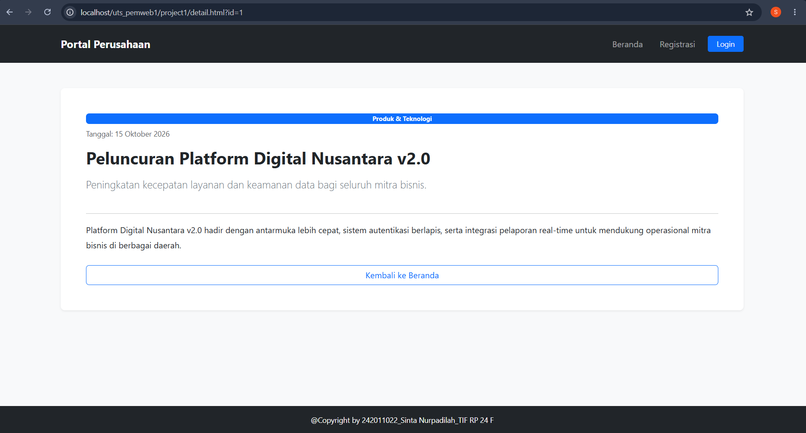
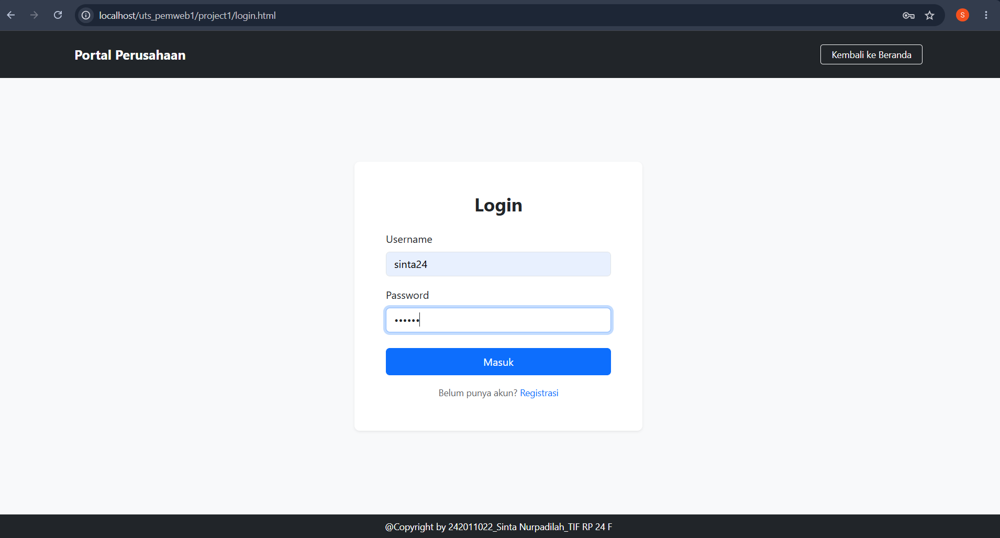
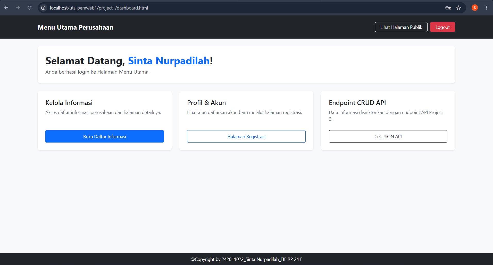
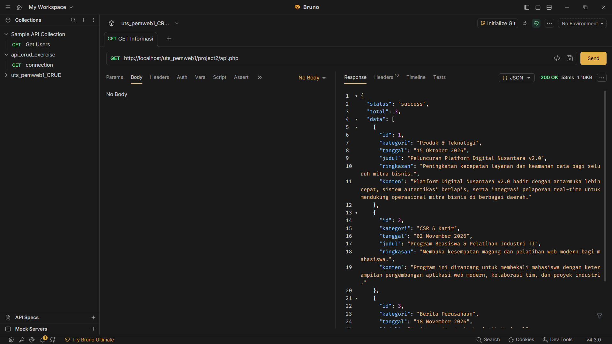
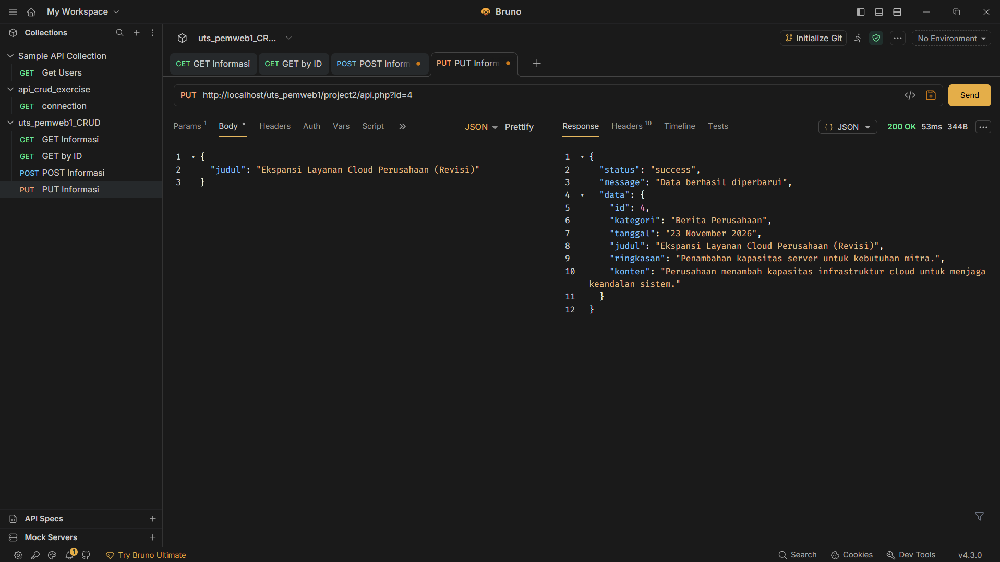

# Tugas Ujian — Pemrograman Web 1

- **Nama:** Sinta Nurpadilah[cite: 1, 7]
- **NPM:** 242011022[cite: 1, 7]
- **Kelas:** TIF RP 24 F[cite: 1, 7]
- **Mata Kuliah:** Pemrograman Web 1[cite: 7]

---

## Project 1: Website Portal Informasi Perusahaan

Website portal informasi perusahaan yang terdiri dari[cite: 1, 7]:
- Halaman Utama (`index.html`)[cite: 1, 6, 7]
- Halaman Detail Informasi (`detail.html`)[cite: 2, 6, 7]
- Halaman Registrasi (`register.html`)[cite: 3, 6, 7]
- Halaman Login (`login.html`) dengan validasi JavaScript (`if`)[cite: 4, 6, 7]
- Halaman Menu Utama (`dashboard.html`)[cite: 5, 6, 7]

### Screenshot Project 1
- **Halaman Utama:**
  [cite: 10]
- **Halaman Detail Informasi:**
  [cite: 10]
- **Halaman Registrasi:**
  [cite: 10]
- **Halaman Login:**
  [cite: 10]
- **Halaman Menu Utama:**
  [cite: 10]

---

## Project 2: CRUD API Data Informasi Perusahaan

Endpoint CRUD API (`project2/api.php`) berdasarkan data *dummy* informasi pada Project 1[cite: 7, 10]:
- `GET /project2/api.php` — Ambil semua data informasi
- `GET /project2/api.php?id={id}` — Ambil data informasi berdasarkan ID
- `POST /project2/api.php` — Tambah data informasi baru
- `PUT /project2/api.php?id={id}` — Ubah data informasi berdasarkan ID
- `DELETE /project2/api.php?id={id}` — Hapus data informasi berdasarkan ID

### Screenshot Pengujian API (Bruno)
- **GET:**
  [cite: 10]
- **POST:**
  [cite: 10]
- **PUT:**
  [cite: 10]
- **DELETE:**
  [cite: 10]